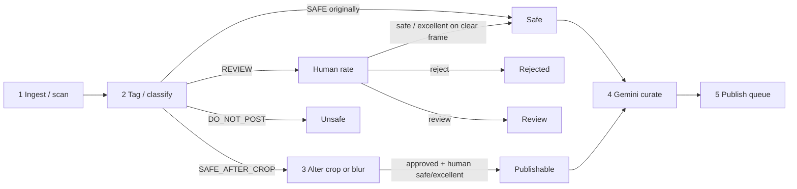

# Picture lifecycle

Operator path: **Review** (rate + crop/blur) → **Curate** (Gemini pick/sort) → **Queue** (human last word → publish).

## Stored vs badge

| Layer | Values | Meaning |
|---|---|---|
| `model_state` (DB) | `SAFE`, `SAFE_AFTER_CROP`, `REVIEW`, `DO_NOT_POST` | Local classifier only. Never rewritten by human rating. |
| `human_rating` (DB) | `reject`, `review`, `safe`, `excellent` | Operator attestation. |
| `effective_state` (API badge) | derived | What the UI filters and tiles show. |

**Safe** vs **Publishable** (presentation only — no DB migration):

- **Safe** — originally clear (`model_state=SAFE`), or the operator cleared a non-remediation state (typically `REVIEW`) with safe/excellent. No crop/blur required.
- **Publishable** — classifier said `SAFE_AFTER_CROP`, operator rated safe/excellent, **and** an approved crop or covering blur is present. Ready for Curate / Queue.

Other badges: **Safe after crop** / **Safe after blur** (still needs alter; same stored state), **Review**, **Rejected** (human reject), **Unsafe** (classifier `DO_NOT_POST`, unrated).

## Where each step happens

| Step | UI | API / jobs |
|---|---|---|
| Ingest | Review → Scan | `POST /api/libraries/{id}/scan` (`io` / `ml` workers) |
| Tag / rate | Review contact sheet + classify (`1`–`4`) | `POST /api/images/{id}/rating` |
| Alter | Review → Crop (`C`) / Blur (`B`) | crop/blur approve endpoints |
| Curate | **Curate** | `POST /api/curation` (async worker job), `POST /api/gemini/label`, reorder / accept / reject picks |
| Queue / publish | **Queue** | `POST /api/curation/queue` or `POST /api/queue` → Approve → Publish |
| Schedule | **Schedule** (`/queue/schedule`) | `POST /api/queue/{id}/schedule` → worker tick publishes when due (gates re-run) |

Gates (`publishing_gate` / `gemini_gate`) still require library attestation, human safe/excellent, not `DO_NOT_POST`, and crop/blur when `SAFE_AFTER_CROP`.
